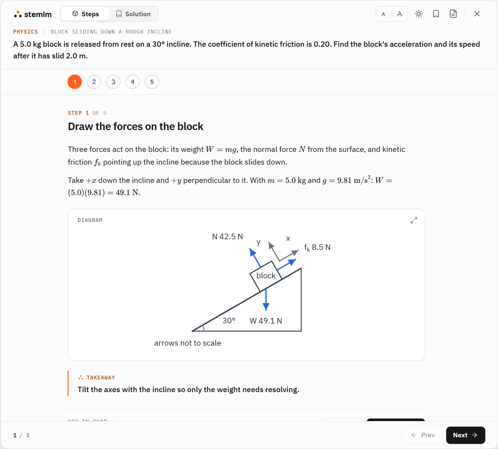
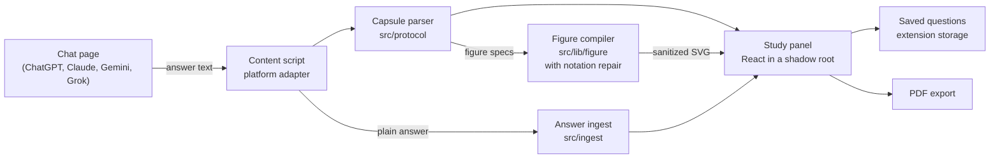

<p align="center">
  <a href="https://stemlm.app">
    <picture>
      <source media="(prefers-color-scheme: dark)" srcset="temp-icon/stemlm-logo-dark.svg">
      
    </picture>
  </a>
</p>

<h3 align="center">Learn STEM. Step by step.</h3>

<p align="center">
  A free, open-source browser extension that turns answers from ChatGPT, Claude, Gemini, and Grok<br>
  into numbered steps, formulas, diagrams and quick checks, right beside your chat.
</p>

<p align="center">
  <a href="https://stemlm.app">Website</a> ·
  <a href="https://chromewebstore.google.com/search/stemLM">Chrome Web Store</a> ·
  <a href="PRIVACY.md">Privacy</a> ·
  <a href="TERMS.md">Terms</a> ·
  <a href="mailto:founders@stemlm.app">Contact</a>
</p>

<p align="center">
  <a href="https://github.com/chayprabs/stemlm-app/actions/workflows/ci.yml"></a>
  <a href="LICENSE"></a>
  
  
</p>

<p align="center">
  <picture>
    <source media="(prefers-color-scheme: dark)" srcset="docs/media/study-panel-dark.webp">
    
  </picture>
</p>

## What stemLM does

Chat assistants explain STEM problems well, but the explanation arrives as one long reply. stemLM puts the study work beside the chat:

1. **Ask.** Type a question or attach a photo or PDF in your AI chat. Press the **stemLM button** beside the chat box, then send.
2. **Study.** Read numbered steps with working, formulas and diagrams beside your chat. Open **Solution** to see them all at once.
3. **Check.** Try a quick check, then reveal the answer. **Ask in chat** adds the step's context to your follow-up question.
4. **Save.** Save a solution with one click. Search **Saved questions** by subject or date to reopen it.
5. **Export.** Download the full solution as a PDF, with formulas and diagrams, or merge saved questions into one revision file.

Already have an answer in the chat? Open the panel and choose **Study the latest answer**. stemLM arranges the reply into steps as it was written and labels it "Structured from the chat answer"; it adds no quick checks or takeaways of its own.

It covers physics, chemistry, maths, biology, computer science, and electrical, mechanical, civil and chemical engineering. The AI works out the subject from your question.

> [!IMPORTANT]
> The steps come from your AI model, and models make mistakes. stemLM makes reasoning easier to follow, but it does not verify it. Check important results, and check diagrams against the problem.

## Works with

| Chat service | Address |
| --- | --- |
| ChatGPT | chatgpt.com |
| Claude | claude.ai |
| Gemini | gemini.google.com |
| Grok | grok.com |

stemLM runs in desktop **Google Chrome 116 or newer** and **Microsoft Edge**. It does not run on phones or tablets. You use your own account with the chat service, so that service's plan, usage limits and terms still apply.

## Install

**From GitHub (v2.0.0).** Download `stemlm-2.0.0-chrome.zip` from the [latest release](https://github.com/chayprabs/stemlm-app/releases/latest), extract it, and load the folder containing `manifest.json` with **Load unpacked** at `chrome://extensions` or `edge://extensions` (enable **Developer mode** first). See [INSTALL.md](INSTALL.md) for installation, updating without losing saved work, and checksum verification. [Read what's new in v2.0.0](docs/releases/v2.0.0.md).

**From the Chrome Web Store.** Open the [Chrome Web Store](https://chromewebstore.google.com/search/stemLM), choose **Add to Chrome**, and pin stemLM from the puzzle-piece menu so its toolbar button is always handy. Open a supported chat and the **stemLM button** appears beside the chat box. Refresh any chat tab that was already open.

**From source.** See [Development](#development) to build the extension and load it unpacked.

## Privacy at a glance

- **No stemLM account.** No login, subscription or payment details.
- **Your study library stays in your browser.** stemLM reads the question and answer on the chat page to build the study view on your computer. It has no server that receives your questions, answers or saved solutions.
- **No extension telemetry in v2.0.0.** This build disables analytics and ships no telemetry endpoint or credential. It has no analytics toggle. The published privacy policy also describes behavior in other releases.
- **You press Send.** The **stemLM button** prepares instructions in your chat; stemLM never sends a message for you. Your chat provider receives what you send, under its own policies.
- **Open source.** Every line of the extension is in this repository under the MIT licence.

The full [Privacy Policy](PRIVACY.md) and [Terms and Conditions](TERMS.md) are Markdown copies of the versions published at [stemlm.app/privacy](https://stemlm.app/privacy/) and [stemlm.app/terms](https://stemlm.app/terms/). The website versions apply if the two ever differ.

## How it works

Pressing the **stemLM button** attaches a plain-text instruction file to your message. It teaches the model one answer format: a single fenced `stemlm` capsule holding the steps, formulas, quick checks and takeaways. Figures inside the capsule are not pictures. They are short, typed `key: value` specs in a small language, for example:

```text
@diagram id=f1 type=plot
fn: x^2 - 4
domain: -3 3
xlabel: x
ylabel: y
eq: y=x^2-4
@enddiagram
```

The extension parses the capsule and compiles every figure spec to SVG in your browser. **There is no language model in the render path:** layout, validation, sanitization and drawing all happen locally and deterministically.



The figure compiler goes **catalog → engine → Scene IR → layout kernel → SVG**. Five core engines (plots, scenes, graphs, tables and circuits) sit beside about 60 template families. Examples:

| Area | Figures |
| --- | --- |
| Physics and mechanics | free-body diagrams, ray optics, fields around point charges, gas-state and thermodynamic diagrams, trusses, shear and moment diagrams, Mohr's circle, cams |
| Electrical and computing | circuits with BJT, MOSFET and op-amp stages, hybrid-π models, two-ports, transmission lines, transformers, motors, phasors, Smith charts, PWM and timing diagrams, K-maps, datapaths and pipelines |
| Chemistry | skeletal structures from SMILES, VSEPR shapes, Newman, Fischer and Haworth projections, MO, crystal-field and Jablonski diagrams, NMR splitting trees, electrochemical cells |
| Chemical and civil engineering | McCabe–Thiele diagrams, reactors, heat exchangers, process flow diagrams, soil phase diagrams, retaining walls, frames |
| Biology | membranes, gel electrophoresis, operons, PCR, neurons, cell division, Ramachandran plots, phylogenetic trees |
| Computer science | flowcharts, state machines and automata, sequence diagrams, binary, search and heap trees with computed traversals, arrays, linked lists, stacks, hash tables, Gantt charts |
| Digital logic | truth tables computed from Boolean expressions, logic-gate circuits derived from the same expressions, K-maps, timing diagrams |
| Statistics and data | bar, grouped and stacked charts, line charts, histograms, pies and donuts, box plots, scatter plots with a fitted line, probability distributions with the shaded probability computed, number lines for intervals and inequalities, Venn diagrams |
| Geometry and calculus | triangles solved from the given sides and angles and drawn to scale, coordinate-plane figures with computed distance, midpoint and slope, vector addition with the computed resultant, the unit circle with exact values, slope fields with integrated solution curves, polar and parametric curves |
| Chemistry, biology and mechanics extras | reaction energy profiles with the activation energy and enthalpy change computed, probability trees with exact path products, projectile motion drawn to scale with range, height and flight time computed, electron configurations and orbital box diagrams computed for every element, Bohr shell models, pedigree charts |
| Tables | matrices, dynamic-programming tables, ICE tables, Punnett squares |

**Exact about content, forgiving about notation.** A spec that compiles as written is drawn as written. One that does not gets a second chance:

- A diagram the model wrote in **Mermaid, Graphviz DOT, a Markdown table or a list of arrows** is translated into a native spec and drawn by the same compiler. Mermaid itself is never run.
- A native spec with **notation slips** is repaired: a misspelt or aliased key (`function:` for `fn:`), a worded range (`-3 to 3`), JSON wrapping, a missing `kind:`, an expression written as `2x` or `x²`.

Neither step may add, drop or change what the figure says, and the result must pass the same strict compiler. A figure drawn this way is marked **Auto-corrected**. Where a result follows from the inputs (the rows of a truth table, a gate network, a tree built by insertion), the engine computes it instead of trusting the model.

**Figures still fail closed.** When a spec is incomplete, ambiguous, or asks for something the engines cannot draw faithfully or legibly, the figure is left out while the explanation stays readable. The panel does not display raw specs or a figure-repair button. Validation checks supported drawing structure; it cannot guarantee that the model understood the question correctly.

## Development

### Prerequisites

- [Node.js](https://nodejs.org/) 20.19 or newer (22 LTS or later recommended)
- [pnpm](https://pnpm.io/) 11
- Google Chrome 116+ or Microsoft Edge

### Build and load

```bash
git clone https://github.com/chayprabs/stemlm-app.git
cd stemlm-app
pnpm install
pnpm build            # production build in .output/chrome-mv3
```

Open `chrome://extensions` (or `edge://extensions`), turn on **Developer mode**, choose **Load unpacked**, and select `.output/chrome-mv3`. A "How to use stemLM" page opens after the first install.

For day-to-day work, `pnpm dev` starts a development build with hot reload in a separate browser profile.

After rebuilding an unpacked install, press the extension's **Reload** control. Open chat tabs pick up the new version automatically; refresh any tab that does not show the **stemLM button**. Reloading closes an open study panel; choose **Load conversation** in the panel to bring the answer back. Keep the extension installed between builds to keep its saved questions.

### Commands

| Command | What it does |
| --- | --- |
| `pnpm dev` | Development build with hot reload (Chrome) |
| `pnpm build` | Production build in `.output/chrome-mv3` |
| `pnpm compile` | Type-check with `tsc --noEmit` |
| `pnpm test` | Run the full Vitest suite (happy-dom) |
| `pnpm test:watch` | Run Vitest in watch mode |
| `pnpm verify` | Type-check, test and build: run this before opening a pull request |
| `pnpm zip` | Package the build for the Chrome Web Store |
| `pnpm release:chrome` | Type-check, test, build and create the release ZIP |
| `npx vitest run src/lib/figure` | Run only the figure-compiler tests |
| `node scripts/visual/shoot.mjs --out .visual` | Photograph the built panel on stand-in pages for the four chat sites, light and dark |
| `node scripts/visual/pages.mjs --out .visual` | Photograph the popup, welcome page, saved questions and settings |
| `node scripts/visual/gallery.mjs specs.json out.png` | Compile a list of figure specs with the shipped compiler and photograph them |

`pnpm dev:firefox` and `pnpm build:firefox` exist, but Firefox is not tested or supported.

See [RELEASING.md](RELEASING.md) for the release process and [CHANGELOG.md](CHANGELOG.md) for version history.

### Project layout

```text
entrypoints/          MV3 entry points: background worker, content script, study panel,
                      toolbar popup, settings, saved-questions library, PDF export, welcome page
src/platforms/        one adapter per chat site: find the composer, attach, read answers
src/content/          the controller that runs in the chat tab and drives the panel
src/protocol/         the instruction file, capsule parser, subject playbooks, quality checks
src/ingest/           plain chat answer -> Markdown with its LaTeX -> steps (no capsule needed)
src/lib/figure/       figure catalog, engines, Scene IR, layout kernel, SVG compiler;
                      families/ = figure packs, intel/ = notation repair and translation
src/lib/              storage, settings, PDF export, math rendering, tab and session plumbing
src/components/       study panel UI: steps, solution view, figures, quick checks, reports
src/state/            the panel's state store
assets/               design tokens, shipped styles, bundled IBM Plex fonts
public/               extension icons
scripts/              icon generation, the study-panel bundle split, visual tools (scripts/visual)
temp-icon/            source artwork for the logo and toolbar icons
```

The content script stays small on chat pages. The study panel, with Markdown, KaTeX and the figure engines, is a separate bundle that loads the first time you open the panel. Fonts ship inside the extension; nothing is fetched from a font CDN.

## Contributing

Bug reports, wrong figures, chat-site breakages and pull requests are all welcome. Read [CONTRIBUTING.md](CONTRIBUTING.md) before you start: it covers setup, the project's rules for figures and protocol changes, and how to test. Everyone taking part follows the [Code of Conduct](CODE_OF_CONDUCT.md).

Found a security issue? Please don't open a public issue; follow [SECURITY.md](SECURITY.md).

## Licence and credits

stemLM's code and original assets are released under the [MIT licence](LICENSE).

- IBM Plex Sans and IBM Plex Mono are bundled under the SIL Open Font License 1.1 ([`assets/fonts/ibm-plex/OFL.txt`](assets/fonts/ibm-plex/OFL.txt)).
- KaTeX and its fonts are MIT-licensed. Every runtime dependency uses a permissive licence (MIT, ISC, BSD, Apache-2.0, Zlib or 0BSD; DOMPurify is dual-licensed MPL-2.0 or Apache-2.0). Run `pnpm licenses list --prod` to check.
- No textbook figure or corpus image is included in this repository.

ChatGPT, Claude, Gemini and Grok are trademarks of OpenAI, Anthropic, Google and xAI, respectively. Their marks are used only to show compatibility. stemLM is an independent project and is not affiliated with or endorsed by them.

## Team

stemLM is built by [Chaitanya Prabuddha](https://github.com/chayprabs), [Rohit Gupta](https://github.com/rohitt-19) and [Abhishek Dogra](https://github.com/ahhbhishek). Feedback, a bug, or a subject we handle badly? Email [founders@stemlm.app](mailto:founders@stemlm.app). We read everything.
